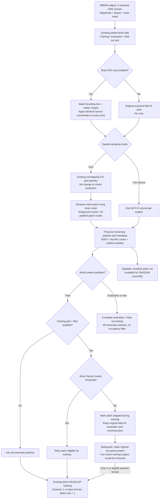
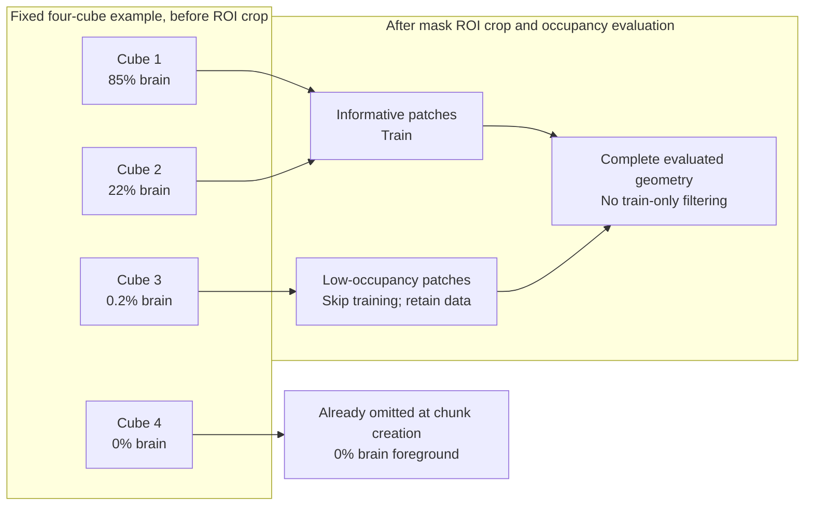

# Brain-aware 3-D MRI patch selection

**Project:** [WGAN_SMEG — Synthetic MRI Echo Generator](https://github.com/AugFabCode/WGAN_SMEG-Synthetic-MRI-Echo-Generator-Lab)  
**Audience:** MRI supervisor, clinical researchers, and machine-learning engineers.  
**Related:** [3-D U-Net sampling methods](UNET_BATCHING_METHODS.md) · [Pipeline](PIPELINE.md) · [Configuration](CONFIGURATION.md)

## Research motivation

A regular grid does not know where the brain is located. The brain may be off-centre, and the field of view and head size differ between subjects. Consequently, a spatial training unit may contain almost exclusively zero-valued background, or a tiny fragment of brain anatomy. The previous chunk builder already discarded patches containing **no brain-mask voxels**; it did not reject patches containing a *small, nonzero* amount of foreground. An almost-black patch therefore still consumed a full 3-D WGAN-GP training iteration.

**A brain-mask bounding-box crop and a patch-occupancy criterion solve different problems:**

- **Brain ROI crop:** Remove outer background *before* dividing a volume into grid patches.
- **Foreground-aware selection:** Calculate brain-mask occupancy *for each resulting patch* and avoid training on nearly empty samples.

Both are optional. The existing deterministic patch geometry, echo conditioning, normalization, 3-D generator/critic and physics baseline are reused. No new data loader or image resampling algorithm is added.

## End-to-end pipeline (rendered by GitHub)



**Important distinction:** The pipeline does **not delete** low-information chunks from the cache. It annotates the source manifest with `brain_fraction` and `training_sample_enabled` and skips low-information patches *only when constructing the training iterator*. The full nonempty source chunk set remains available for validation, held-out testing, and spatial reconstruction. Evaluation patches are not removed by a training-only sampling policy.

## Why the original four-cube visualization revealed the problem

In some earlier experiments the acquired volume was divided into **four large cubes**. Four large, fixed cubes do not imply four anatomically balanced brain regions: an off-centre brain can be concentrated in only one or two cubes. The current repository's active default is `CHUNK_GRID=[5,5,3]` (75 nominal 3-D positions), not four; the *same positional-bias problem applies to either grid*. The count of retained patches also depends on whether they intersect the mask.



The values in the above schematic are **illustrative**, not cohort measurements. For a 3% threshold, a patch with 0.2% occupancy is excluded from the training iterator. A 0%-occupancy patch is already omitted from the original cache by the existing empty-mask rule.

## Mathematical definition

For a 3-D patch `p` with extracted brain mask `M_p`, including its configured zero padding:

```text
brain_fraction(p) =
    number of patch voxels for which brain_mask > 0.5
    --------------------------------------------------
      patch_height * patch_width * patch_depth
```

The denominator counts **all spatial voxels presented to the model**, including zero padding, not merely the tight ROI or occupied brain voxels. This yields values in `[0, 1]`. The fraction is computed **once from the mask**, independent of whether the data path is magnitude or phase, independent of target echo time, and without intensity-based thresholding that might favour specific echo contrasts.

For training grid patches only, a patch is eligible when:

```text
training_sample_enabled =
  (brain_fraction >= MIN_BRAIN_FRACTION_PER_CHUNK)
```

Selection is applied only if `DROP_LOW_INFORMATION_CHUNKS=true`. If every nonempty patch for one training subject falls below the threshold, **the subject's highest-occupancy patch is retained** so that the patient is not silently removed from the assigned training partition. At least one patch per training subject therefore survives. Tie order follows deterministic grid order.

Neither the occupancy threshold nor a high foreground ratio guarantees that a patch contains medically relevant vessels. The mask serves as a coarse surrogate for anatomy, not a vessel-quality score.

## Configuration and dashboard controls

| Setting | Default | Effect |
|---|---|---|
| `UNET_BATCHING_MODE` | `grid_patches` | Standard grid or full-volume geometry |
| `UNET_BRAIN_CROP_ENABLED` | `false` | Optional subject-specific brain bounding-box crop |
| `UNET_BRAIN_CROP_MARGIN_VOXELS` | `4` | Extra per-side context before splitting |
| `DROP_LOW_INFORMATION_CHUNKS` | `false` | Opt-in *training-only* exclusion of almost-empty grid patches |
| `MIN_BRAIN_FRACTION_PER_CHUNK` | `0.03` | Minimum fraction of foreground mask voxels in the padded patch |
| `CHUNK_GRID` | `[5,5,3]` | Number of deterministic divisions along each spatial axis |
| `CHUNK_OVERLAP_VOXELS` | `20` | Context overlap for grid-based patches |
| `UNET_PAD_MULTIPLE` | `8` | Zero padding to a model-compatible spatial multiple |
| `OVERWRITE_DERIVED` | `false` | Rebuild derived chunk/cache manifests when selection changes |

Filtering is inactive in `full_volume` mode (there is only one anatomical sample per case). It is also inactive for `eval` and `test` partitions, regardless of the checkbox. The UI disables inapplicable filtering controls while preserving their configured values.

### Reproducible example

```json
{
  "UNET_BATCHING_MODE": "grid_patches",
  "UNET_BRAIN_CROP_ENABLED": true,
  "UNET_BRAIN_CROP_MARGIN_VOXELS": 4,
  "DROP_LOW_INFORMATION_CHUNKS": true,
  "MIN_BRAIN_FRACTION_PER_CHUNK": 0.03,
  "UNET_PAD_MULTIPLE": 8,
  "OVERWRITE_DERIVED": true
}
```

From the dashboard, apply the settings, choose **Rebuild derived training chunks and fast NumPy cache**, then run **Preprocess data** before starting a *new* training run. Reuse the unchanged preprocessed input NIfTIs and existing patient split. Enabling the training filter or changing its active threshold changes the derived-data signature; a stale manifest is rejected rather than silently used. Leaving the filter disabled preserves the earlier data signature, so an unchanged existing cache does not need a rebuild solely because this feature was installed. Do not enable `REBUILD_PATIENT_SPLIT` just to change patch sampling.

### Interpreting the manifest

- `brain_fraction`: continuous mask-occupancy value, with zero padding included in the denominator.
- `training_sample_enabled`: whether the chunk is eligible for training.
- `case_id`, `split`, `chunk_id`: unchanged provenance and partition membership.
- `source_start_*`, `source_end_*`, `roi_start_*`, `roi_end_*`, `pad_before_*`, `pad_after_*`: original spatial geometry, still available for stitching.

The preprocessing log shows `nonempty chunks` and `eligible for training` by case. When the mode is grid patches and filtering is enabled, the difference is the number of nonempty chunks the training iterator will skip.

## Evaluation protocol for a defensible comparison

Run at least three controlled variants with identical patient splits, model hyperparameters, input-echo distributions, training seeds and training budgets:

1. **Baseline:** Fixed grid, no ROI crop, no near-empty training filter.
2. **Crop only:** Fixed grid, mask-based brain ROI crop, no near-empty training filter.
3. **Crop + selection:** Same grid and ROI parameters, with `DROP_LOW_INFORMATION_CHUNKS=true` and threshold `0.03`.

Report the distribution of patch occupancy per case, eligible versus skipped counts, GPU memory, epoch time, the number of optimizer steps, and held-out magnitude/phase quality (MAE/RMSE, PSNR, SSIM, NCC as appropriate). Report both **equal-epoch and equal-optimizer-step** comparisons: dropping patches changes the number of updates per epoch, and comparing only epochs can mislead.

Assess downstream SWI/QSM reconstructions **over a complete, spatially consistent volume**, not on the retained training patches alone. Always preserve subject-level train/eval/test separation. If applying strong brain erosion, inspect whether superficial vessels or boundary tissues have been excluded from the mask and vary the safety margin and occupancy threshold accordingly.

**Scientific caution:** The 3% threshold is a plausible *starting hypothesis*, not an empirically optimized cut-off. Compare it with 0%, 1%, and 5%, record the fraction distribution, and watch for loss of cortical, peripheral or small-vessel context. Actual compute improvements and reconstruction accuracy require an ABRIM/A6000 experiment; the unit tests validate implementation logic, not scientific superiority.

## Implementation and automated tests

- `echo_gen_preprocessing.py`: `annotate_training_patch_specs()`, shared `select_ceaset_split_rows()`, manifest annotation, nonempty geometry retention and per-case logging.
- `echo_gen_training.py`: both the direct Python iterator and the existing `tf.data` path apply the training-only eligibility flag. Epoch step estimates and preliminary sample validation follow the same selection.
- `echo_gen_config.py`, `echo_gen_defaults.json`: typed configuration and `[0,1]` threshold validation.
- `echo_gen_dashboard.html`: checkbox, threshold field, disabled states, help text.
- `test_echo_gen_unet_batching.py`: synthetic occupancy tests, all-low fallback, train/eval/test split isolation and full-volume compatibility.
- `.github/workflows/unet-batching-tests.yml`: automated Python 3.11 preprocessing regression suite.

All technical documentation in this change is written in English. The two Mermaid diagrams render directly in GitHub's Markdown viewer and remain text-editable for scientific review.
