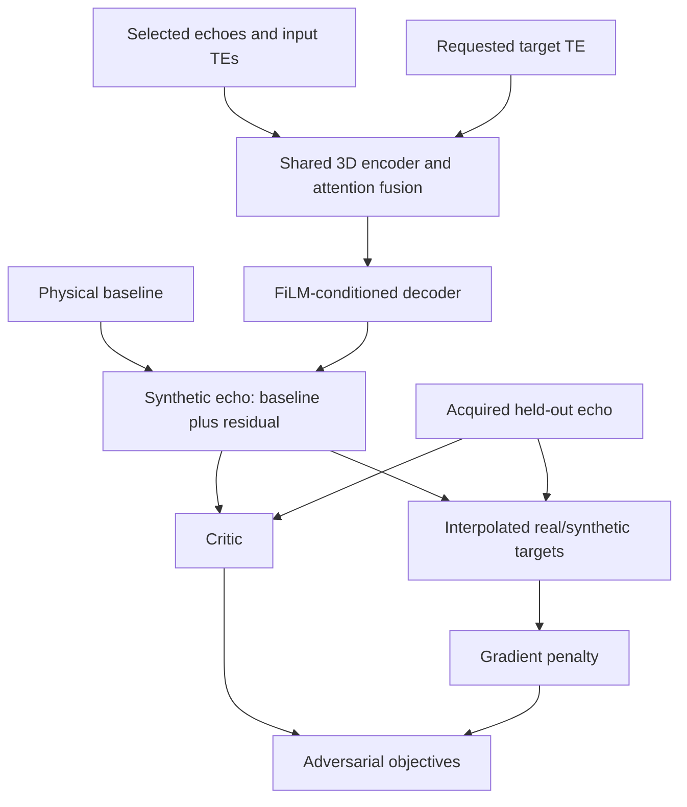

# Pipeline and architecture

[README](README.md) · [Configuration](CONFIGURATION.md) · [Development](DEVELOPMENT.md)

## Scientific scope

The pipeline learns magnitude and phase echo synthesis from ABRIM MEGRE data. At training time, one actually acquired echo is held out as the supervised target and 1–4 different echoes form the input set. The requested target TE conditions the generator. Sampling includes forward extrapolation, interpolation, backward extrapolation and other arrangements; training is not restricted to early-to-late synthesis.

The intended downstream workflow combines acquired and synthetic echoes for SWI/QSM research. The split scripts implement data preparation and model training. They do not implement an automatic end-to-end reconstruction/export workflow or establish clinical equivalence to acquired late echoes.

## Preprocessing

1. Discover subject/session/run cases, match nine echoes, read TE metadata and identify phase sources.
2. Validate NIfTI dimensions, spatial grids, affines and finite values.
3. Obtain filtered phase from an existing `filteredphase_orig` volume or CLEAR-SWI with genuine phase inputs.
4. Build a TE3 magnitude BET mask (`-f 0.2`, robust center and mask output by default), then apply the configured 2 mm erosion.
5. Write physical-value masked magnitude/phase images and optional shell-style normalized QC/export images.
6. Create or reuse a deterministic subject-level train/evaluation split; default evaluation fraction is 20%, seed 42.
7. Compute physical-value normalization statistics, create overlapping chunks and build the uncompressed float32 NumPy cache.
8. Record the derived-data completion signature and validate artifact consistency.

Chunk cores cover remainder voxels. Padding makes the spatial dimensions divisible by the generator's stride of eight. The default grid is 5 × 5 × 3 with 20-voxel overlap; resulting memory use depends on the original volume shape.

Training validates the artifact signature, cohort, partition assignments, per-echo statistics and referenced cache files. It additionally exercises the training sampler for both modalities and both partitions before the epoch loop. Preprocessing performs artifact validation without importing the training module.

## Two normalization domains

| Domain | Files | Use |
|---|---|---|
| Physical values | `mag_bet/`, `phase_bet/` and associated caches/statistics | Model input/target sampling and reversible normalization |
| Shell-style normalized exports | `mag_norm/`, `phase_norm/` | QC/export; not the CEASET training domain |

Magnitude scaling is derived from the selected input echoes' whole-brain statistics, using the earliest usable input and robust percentile handling. Phase scaling derives from the selected inputs' robust absolute phase/TE rate, referenced to 30 ms. Held-out target information must not determine the dynamic sample scale. Undo the sample scale when interpreting outputs in physical units.

The nonlinear phase QC/export transform uses an amplitude across all nine echoes; it is deliberately excluded from model training. The fixed TE3 mask and filtered phase remain preprocessing inputs. This does not demonstrate an acquisition chain independent of all held-out echoes: deployment with fewer echoes must retain the required mask input or separately validate an available-echo masking/phase-processing strategy.

## Generator and critic

The generator shares a 3D encoder across selected echoes, combines features with attention and conditions its decoder on TE. It retains learned TE embeddings and an optional raw-TE FiLM path. The output is a deterministic physics baseline plus a learned residual, allowing local detail to depart from the coarse physical prior.

The magnitude baseline uses exponential decay fitting across multiple inputs, or a configured R2* prior for a single echo. The phase baseline uses local phase/TE behavior with magnitude-derived SNR weighting and robust frequency weighting enabled by default.

The critic scores real and synthetic target volumes. It provides an adversarial signal; its score is not a calibrated probability or a clinical image-quality measurement.

## Losses

The critic minimizes the implementation's WGAN-GP objective:

$$L_D = \mathbb{E}[D(\hat{x})] - \mathbb{E}[D(x)] + \lambda_{GP}\,\mathbb{E}\left[(\|\nabla_{\tilde{x}}D(\tilde{x})\|_2-1)^2\right].$$

Here $x$ is the acquired target, $\hat{x}$ the generated target, and $\tilde{x}$ an interpolated real/synthetic target. The default gradient-penalty coefficient is 10. The dashboard's Wasserstein gap uses the opposite score difference, $\mathbb{E}[D(x)]-\mathbb{E}[D(\hat{x})]$.

Generator training combines reconstruction, adversarial, edge and coarse structural physics terms. The physics term compares blurred prediction/baseline with intensity and local structural components; it is not a voxelwise residual penalty intended to force fine vessels to match the baseline. Perceptual loss is disabled by default and requires separately supplied RadImageNet weights if enabled.

An optional continuous-TE auxiliary update uses coarse physics supervision at random 4–40 ms TEs every fourth batch by default. It does not supply an acquired target, an adversarial target or evidence of accuracy throughout that range. Model quality still requires independent evaluation.

## Training and monitoring

Magnitude and phase train sequentially. The current stable path uses a direct Python loop, batch size 1, a dynamic echo axis and float32 policy. Single-GPU mode puts generator and critic on logical GPU 0; dual-GPU mode puts generator on GPU 0 and critic/gradient penalty on GPU 1.

The default critic schedule is two updates per magnitude batch and one per phase batch. Fixed validation uses a deterministic protocol. Lowest fixed-validation MAE selects the best generator; early stopping monitors meaningful improvements after its configured starting epoch.

| Plot | Meaning |
|---|---|
| Generator loss | Combined generator training objective |
| Critic loss | Critic objective, including gradient penalty |
| Wasserstein gap | Real-minus-synthetic critic score difference |
| Gradient penalty | Critic gradient regularization diagnostic |
| Reconstruction loss | Generator reconstruction component |
| Fixed validation MAE | Validation error used for best-checkpoint selection |

Losses have different scales and purposes. A favorable critic gap alone does not establish fidelity, preserved anatomy, or improved SWI/QSM output. Compare held-out image reconstructions and downstream results in addition to training curves.

## Saved artifacts and downstream use

Checkpoints and history filenames include the run identity described in [Configuration](CONFIGURATION.md). Optimizer-inclusive TensorFlow state supports training continuation; generator `.weights.h5` files contain weights rather than a complete standalone exported inference graph. Recreate the matching generator architecture and normalization using the saved configuration before loading those weights.

The source notebook's optional inference/evaluation cells are not bundled as new standalone commands. They may need explicit checkpoint paths for the new naming convention. Automatic SWI/QSM assembly, reconstruction and quantitative downstream evaluation remain separate work.

Live MRI previews reuse the existing fake tensor from the first critic update. A detached, downsampled central transversal chunk slice is returned separately from scalar metrics and is never included in a loss. Publishing occurs after the batch, so the displayed image represents the output before that batch’s subsequent weight updates.
