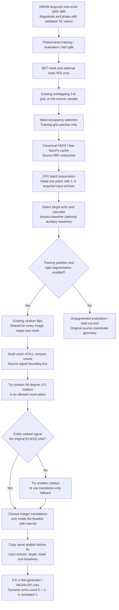
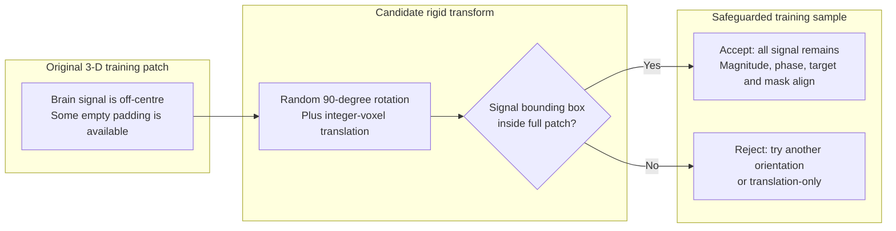

# Signal-safe 3-D MRI batch augmentation

**Project:** [WGAN_SMEG — Synthetic MRI Echo Generator](https://github.com/AugFabCode/WGAN_SMEG-Synthetic-MRI-Echo-Generator-Lab)  
**Scope:** TE-conditioned 3-D WGAN-GP / U-Net training, magnitude and phase.  
**Related:** [Brain-aware patch selection](PATCH_SELECTION_PIPELINE.md) · [U-Net batching methods](UNET_BATCHING_METHODS.md) · [Configuration](CONFIGURATION.md).

## Objective

Real MRI brains are not perfectly centred. After subject-specific brain cropping and foreground-aware patch selection, the remaining 3-D samples can still benefit from spatial variety. This option creates different orientations and translations of informative brain-containing samples while preserving the **complete original nonzero signal content within the same patch dimensions**.

### Essential guarantee

> No nonzero voxel from the loaded patch may be removed because a rotation or translation would carry it outside the patch.

The implementation uses **exact 90-degree rotations in voxel coordinates** (quarter-turns 1, 2, or 3) and **integer-voxel translations**. This is a deliberate medical-imaging decision: it preserves source values exactly, with no bilinear/trilinear interpolation, artificial interpolation of wrapped phase, or intensity jitter. It does **not** implement continuous-angle arbitrary-degree rotations.

The check uses the **union of nonzero voxels from every tensor** in a sample: selected input echoes, acquired target echo, physics baseline, brain mask, and optional continuous-TE auxiliary baseline. It does not assume that an eroded BET mask encloses every nonzero image voxel.

## End-to-end pipeline (GitHub Mermaid rendering)



**Practical architecture:** Rotation and translation occur during **CPU training-batch preparation after reading prepared patches**. They are intentionally not materialized into the preprocessing cache. This gives new random variants across epochs without multiplying dataset storage, corrupting the canonical source-coordinate manifest, or creating augmented validation/test datasets. This is part of *training data preprocessing*, not a re-run of FSL/BET.

## How signal clipping is prevented

For a patch of fixed spatial shape `S = (H, W, D)`, define the original signal support as:

```text
support(x, y, z) =
    any(input_echo[:, x, y, z, :] != 0)
 OR any(target[x, y, z, :] != 0)
 OR any(physics_baseline[x, y, z, :] != 0)
 OR any(brain_mask[x, y, z, :] != 0)
 OR any(aux_physics_baseline[x, y, z, :] != 0)  # when present
```

For an attempted 90-degree rotation, compute the axis-aligned bounding box of the entire rotated support with half-open bounds `[lo, hi)`. An integer placement offset `t` is valid **if and only if**, for each axis `d`:

```text
0 <= lo[d] + t[d]
hi[d] + t[d] <= S[d]
```

The implementation intersects that safe interval with the requested translation range around the original anatomical centre. If no offset fits the rotated support, that orientation is rejected **before** any image is transformed. An alternative right-angle orientation is attempted, followed by translation-only. If the patch occupies every usable boundary and cannot move, it remains at its safe position.

Once an orientation is accepted, the exact same index mapping is applied to every selected input echo and associated supervision tensor. Arrays retain their original `[H,W,D,1]` dimensions (echo stacks retain `[K,H,W,D,1]`). All original nonzero source voxels are represented exactly once in the output. Numerical values are copied, never interpolated.

This guarantee concerns **signal already present in the extracted source patch**. If an earlier regular-grid split truncated anatomy at a patch boundary, no augmentation algorithm can recover those missing neighbouring voxels. Keep sufficient patch overlap and mask ROI margin.

### Before / after examples (conceptual, not measured data)



## Configuration

| Setting | Default | Meaning |
|---|---|---|
| `TRAINING_SAFE_RIGID_AUGMENTATION` | `false` | Opt-in augmentation, preserving the original experiment unless enabled |
| `TRAINING_SAFE_TRANSLATION_VOXELS` | `4` | Maximum randomized centre displacement per spatial axis, subject to whole-signal containment |
| `TRAINING_SAFE_ROTATION_PROBABILITY` | `0.75` | Probability of attempting a non-identity right-angle orientation, between 0 and 1 |
| `TRAINING_SAFE_ROTATION_PLANES` | `in_plane` | `in_plane` rotates spatial axes 0 and 1 only; `all` permits every voxel plane |
| `TRAINING_RANDOM_FLIPS` | `true` | Existing coordinate-aligned random flips, preserved unchanged |
| `TRAINING_SAMPLES_PER_CHUNK_PER_EPOCH` | `1` | How many independently seeded echo configurations/augmentations to draw from each eligible patch per epoch |

**Recommended research starting point:**

```json
{
  "TRAINING_SAFE_RIGID_AUGMENTATION": true,
  "TRAINING_SAFE_TRANSLATION_VOXELS": 4,
  "TRAINING_SAFE_ROTATION_PROBABILITY": 0.75,
  "TRAINING_SAFE_ROTATION_PLANES": "in_plane",
  "TRAINING_SAMPLES_PER_CHUNK_PER_EPOCH": 2
}
```

These settings can be edited in **Training setup → Signal-safe 3-D batch augmentation**, or through the advanced JSON field. The model still trains on at most four actual input echoes in each sample and retains the existing minibatch size of 1.

### Why `in_plane` is the default

The ABRIM acquisition may have unequal voxel spacing along its slice direction. Rotating in an index plane that mixes substantially different voxel spacings would alter physical anatomical scale without interpolation. Therefore, the default is an in-plane rotation of the first two **processing axes**, which are expected to represent the in-plane acquisition dimensions. Validate voxel spacing and array orientation for your dataset. Enable `all` only if source samples are isotropic and rotating across all three axes is scientifically defensible; the code does not automatically verify spacing from the HDF5/NumPy cache. The feature makes an exact operation in **voxel coordinates**, not a scanner/world-space affine rotation.

### Determinism and modality alignment

Each training sample already has a deterministic NumPy random seed derived from the training seed, epoch, modality and sample index. The new augmentation consumes this same generator; a repeat with the identical seed and configuration produces identical transformed tensors and metadata. Each randomly selected echo subset, acquired target, input/auxiliary physics baseline and mask receives **one shared transform**, never independently sampled transformations. No target echo time or intensity normalization is changed.

The returned sample metadata includes `spatial_augmentation` with the rotation plane, number of quarter-turns, placement offset, intended centre translation and pre-existing flip axes. It is attached to the in-memory batch only; no augmented images or previews are persisted.

### Derived-cache and checkpoint behaviour

Because the canonical HDF5/NumPy chunks are unchanged, **do not enable `OVERWRITE_PREPROCESSING` or `OVERWRITE_DERIVED` just to turn on augmentation**. Existing valid caches remain reusable. Enabling augmentation changes the resolved training configuration and consequently generates a distinct model run identity. Do not silently resume incompatible checkpoints: start a new model experiment or intentionally resume a run with matching settings.

### Evaluation and SWI/QSM reconstruction

The augmentation runs only when a training sampler explicitly requests `augment=True`. The existing validation and held-out testing samplers request `augment=False`. Reconstructed SWI/QSM data must use the untransformed source-coordinate patch set and matching NIfTI/header geometry. These training-only transformations are **not** spatial transforms for final NIfTI assembly.

### Memory and performance

This CPU-side implementation builds a support map, searches safe orientations and copies a transformed version of each tensor. It adds memory bandwidth and host preprocessing time relative to flips alone, but not extra model activations or GPU layers. The additional CPU time should be benchmarked with real A6000 runs; no speed-up or clinical benefit is assumed. Disabled-by-default preserves the previous performance.

### Verification and limitations

The dependency-light regression suite `test_echo_gen_augmentation.py` tests:

- exact conservation of voxel values and signal counts across random seeds;
- co-registered target, echo channels, brain mask and auxiliary baseline;
- translation-only, rectangular-patch orientation constraints and full-boundary cases;
- signal outside an eroded brain mask;
- deterministic replay, disabled behaviour and failure on invalid/non-finite inputs.

The GitHub Actions workflow compiles edited code and runs the preprocessing/geometry tests on Python 3.11. Synthetic tests establish discrete geometric safety, **not** improvements to network generalization, vessel visibility, held-out metrics, clinical validity, or model convergence.

**Suggested comparison:** Hold the patient split and optimizer-step budget constant, and compare unaugmented baseline vs flips-only vs flips + signal-safe rigid augmentation. Review patch occupancy, epoch CPU wait time, magnitude/phase metrics, and held-out SWI/QSM performance. A conservative 4-voxel translation and in-plane quarter-turn rotation are starting parameters, not validated optima.
